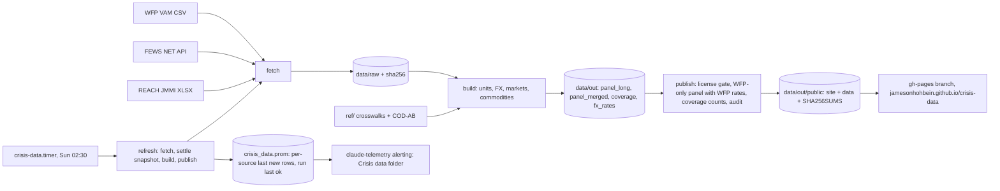

# Architecture

crisis-data 001, conflict-market price panel (spec `specs/001-conflict-market-prices.md`).
P1 (fetch, build, tests), P2 (public bundle, site) and P3 (weekly refresh,
alerts) are built. Only WFP prices are published; FEWS NET and REACH JMMI feed
coverage counts only.

