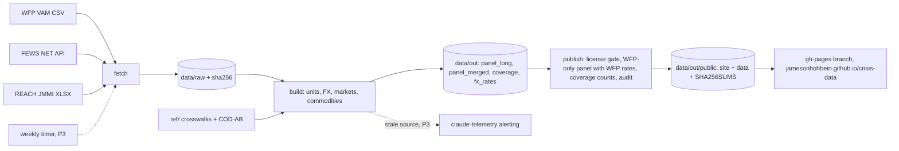

# Architecture

crisis-data 001, conflict-market price panel (spec `specs/001-conflict-market-prices.md`).
P1 (fetch, build, tests) and P2 (public bundle, site) are built. Only WFP prices
are published; FEWS NET and REACH JMMI feed coverage counts only. The weekly
timer and alert rule are P3.

