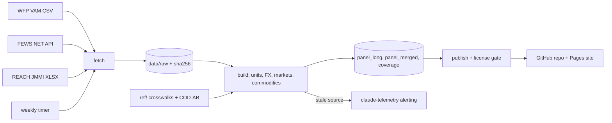

# Architecture

crisis-data 001, conflict-market price panel (spec `specs/001-conflict-market-prices.md`).
P1 (fetch, build, tests) is built; publish runs the license gate in `--dry-run`
only, and the weekly timer and alert rule are P3.

