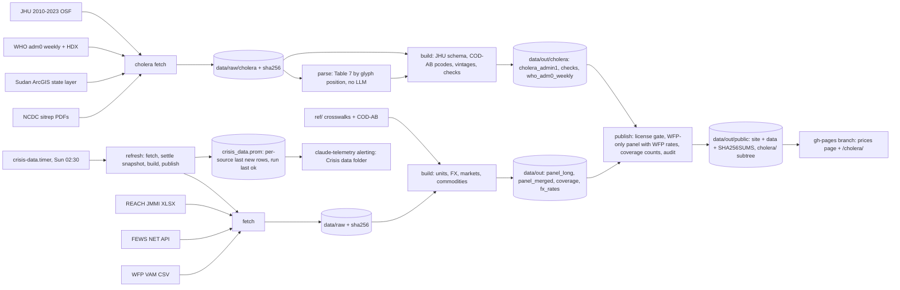

# Architecture

crisis-data has two products sharing one publish step and one Pages site.

- 001, conflict-market price panel (`specs/001-conflict-market-prices.md`).
  P1 (fetch, build, tests), P2 (public bundle, site) and P3 (weekly refresh,
  alerts) are built. Only WFP prices are published; FEWS NET and REACH JMMI feed
  coverage counts only.
- 002, subnational cholera backfill 2024-25 (`specs/002-cholera-backfill.md`).
  P1 and P2 are built: Nigeria (NCDC sitreps) and Sudan (ArcGIS state layer) in
  the JHU schema, on `/cholera/`. South Sudan is excluded (no tables), so there
  is no cholera refresh: publish carries the last cholera build in
  `data/out/cholera/` into every bundle, including the weekly 001 refresh.

