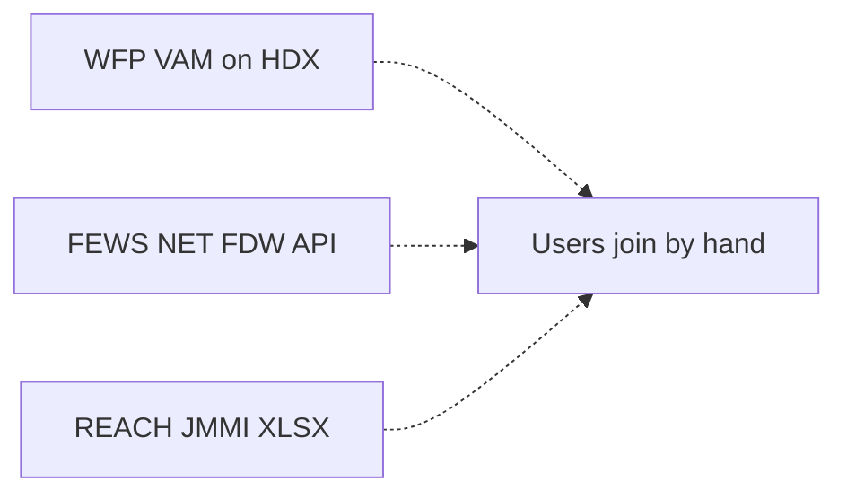
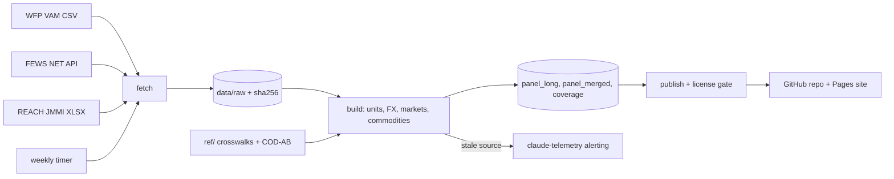

# 001: Conflict-market price panel (Sudan, Yemen)

Status: approved 2026-10-12 (chat:b3c9dc6b).

**Goal:** a public, CC BY, monthly staple-price panel for Sudan and Yemen that
merges WFP, FEWS NET and REACH JMMI into one schema, plus a coverage map of
where each source stopped reporting after 2024. Nobody publishes this merge
today; 2025-26 funding cuts left each source with holes the others partly fill.

## Shape

Repo `~/dev/homelab/crisis-data` (umbrella for later domains; this is product
001). Python, DuckDB, one CLI:

    crisis-data fetch [--source wfp|fewsnet|jmmi]
    crisis-data build            # raw -> panel + coverage
    crisis-data publish [--dry-run]

Raw downloads land in `data/raw/<source>/<YYYY-MM-DD>/` with a sha256
manifest. They are untrusted input: parsed with `python -I`, never executed or
imported. Outputs go to `data/out/` as Parquet and CSV.

## Sources (`sources.yaml`, one entry each, with license status)

| Source | Fetch | Notes |
|---|---|---|
| WFP VAM | HDX CSV `wfp_food_prices_sdn.csv`, `_yem.csv` | CC BY-IGO, verified. Includes market exchange-rate series |
| FEWS NET | FDW API `fdw.fews.net/api/marketpricefacts/` (no auth) | Redistribution terms **unverified**: publish gate |
| REACH JMMI | XLSX from the IMPACT repository, per round | License **unverified**: publish gate. Yemen switched to non-food items Apr 2026; food series ends there |

## Panel schema (long, one row per source observation)

`source, country, admin1_pcode, admin2_pcode, market_id, market_name_src,
lat, lon, commodity, commodity_src, unit_src, qty_factor, price_local,
currency, currency_zone, fx_rate, fx_source, price_usd, price_per_std_unit,
month, obs_date, raw_ref`

- **Commodities:** crosswalk `ref/commodities.csv` maps source items to about
  15 staples (sorghum, wheat flour, rice, millet, vegetable oil, sugar,
  lentils, beans, salt, diesel, petrol, water). Unmapped items are dropped and
  counted in the build report, never silently.
- **Units:** normalized to kg, L or each via `ref/units.csv`.
- **Currency:** USD uses the market exchange rate the same source reports for
  the same month and place where one exists, else WFP's series for that
  admin1. Yemen rows carry `currency_zone` (Aden-governed vs Sana'a-governed
  rial; the rates differ about 3x, and mixing them is the commonest error in
  published Yemen price data).
- **Markets:** matched to OCHA COD-AB admin boundaries (HDX) by coordinates
  where given, else fuzzy name within admin1. Below-threshold matches go to
  `ref/markets_review.csv`, committed and hand-resolved.

**Merged view** `panel_merged`: one row per market x commodity x month, source
priority JMMI > WFP > FEWS NET, flagged `disagree` when sources differ by more
than 20% in USD per standard unit. All source values stay in `panel_long`.

## Coverage (the blackout map)

`coverage`: source x country x admin1 x month, with observed market-commodity
pairs and last month seen. Published as a per-source choropleth with a month
slider from Jan 2023 and a "lost since 2024" layer.

## Publish

- Public GitHub repo `crisis-data`. Data CC BY 4.0 with per-source attribution
  in `ATTRIBUTION.md`; code MIT.
- Static site on GitHub Pages: MapLibre map, method note, CSV/Parquet
  downloads with checksums.
- **Publish gate:** `publish` refuses any source whose `license:` is not
  `verified`. If FEWS NET or JMMI terms forbid redistribution, their rows feed
  only the coverage counts, not the panel.
- No HDX upload in 001 (needs an organisation account in Jameson's name).

## Refresh

Weekly systemd user timer: fetch, build, publish. A source that fails, or
returns no new rows for 5 weeks, trips a rule in `claude-telemetry/alerting/`
(the incident path). No second notifier.

## Phases

P1 fetch + build + tests, local only. P2 public repo + site. P3 timer + alert.

## Tests

- **T1** Each fetcher returns 2024-2026 rows for Sudan and Yemen; the raw
  snapshot is written with a sha256 manifest.
- **T2** 100% of panel rows have a unit in {kg, L, each} with a factor from
  `ref/units.csv`; dropped rows counted per reason in `build_report.json`.
- **T3** Every Yemen row has `currency_zone`; a fixture with one Aden and one
  Sana'a row converts with different rates.
- **T4** At least 95% of rows matched to admin1 and 85% to admin2; unmatched
  rows listed in the review file.
- **T5** 20 random panel rows, checked by hand against raw source, match
  price, unit and month.
- **T6** Coverage last-seen month per source x country equals the max date in
  that source's raw snapshot.
- **T7** `publish` exits non-zero when a source's license is unverified and
  its rows would enter the panel.
- **T8** Same raw inputs produce byte-identical `data/out/`.
- **T9 (P2)** Site serves, map renders both layers, downloads match checksums.
- **T10 (P3)** A simulated stale source fires the alert rule once.

## Architecture

### Before

No system exists; the sources are separate and unjoined.

### After

