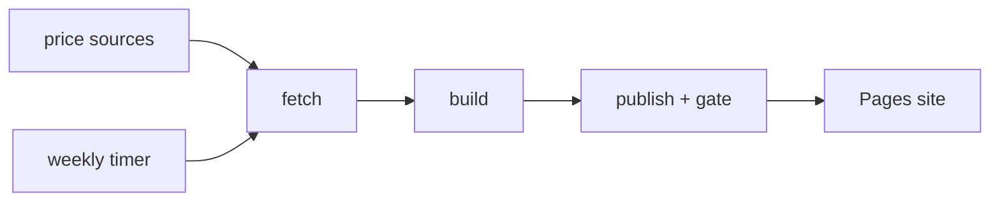
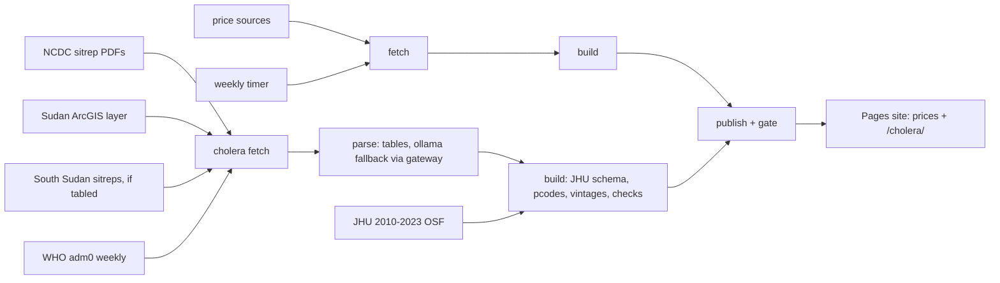

# 002: Subnational cholera backfill, 2024-25 (Nigeria, Sudan, South Sudan)

Status: approved 2026-10-14 (chat:b3c9dc6b).

**Goal:** extend the only open subnational cholera dataset (JHU, 2010-2023,
CC BY 4.0, OSF 2ncf7) through 2024-25 in its own schema, for the countries
where admin1 tables exist publicly. The output lets anyone continue JHU's
series without rework. 2026 subnational data is behind WHO's access form; a
request goes out alongside and is a later spec if granted.

## Scope

| Country | Source | Period | Measures |
|---|---|---|---|
| Nigeria | NCDC cholera sitrep PDFs (36 states + FCT) | 2024 W1 to 2025 W9 (series ended) | weekly + cumulative suspected cases, deaths |
| Sudan | WHO-hosted ArcGIS `Sudan_Weekly_Cholera_Cases_WFL1` (pcoded) | 2024 W1 to 2025 W45 | weekly cases only (no deaths in source) |
| South Sudan | MoH/WHO cholera sitreps | Sep 2024 to latest | **conditional**: included only if the sitreps carry county or state tables; P1 checks first and records the verdict |
| All three | WHO global dashboard adm0 weekly (CC BY-IGO via HDX) | same | national reference totals, used only for checks |

Out: DRC, Afghanistan, Yemen, Mozambique (no public admin1 tables found).

## Shape

Same repo, new package `crisis_data/cholera/`, CLI:

    crisis-data cholera fetch|build|publish

Raw goes under `data/raw/cholera/<source>/<date>/` with a sha256 manifest,
untrusted, never executed.

## Extraction

- NCDC PDFs: deterministic table parsing (pdfplumber/camelot, column
  positions per layout version). No LLM by default.
- Fallback: a document the parser cannot balance (see C2) may go to local
  ollama through the gateway (127.0.0.1:11434, the guarded path). Every
  LLM-extracted row carries `method=llm` and must still pass C2; failures are
  listed, never published.
- Sudan: ArcGIS REST query, paged, all features.

## Schema

JHU's column set and conventions, read from the OSF release at build time,
plus `source_doc` (file + page), `vintage` (issue date of the document a value
came from) and `method` (parse|api|llm). Admin1 mapped to OCHA COD-AB pcodes.
Rows hold values exactly as reported. Where a later issue revises an earlier
week, both vintages are kept and the latest is flagged `current`.

## Checks published with the data

`checks.csv` per country and week: state sum vs printed national row,
cumulative continuity (cum(t) minus cum(t-1) vs weekly(t)), our national sum
vs WHO adm0. Disagreements are shown, not corrected.

## Publish

- New page `/cholera/` on the existing Pages site: admin1 choropleth with a
  week slider, per-country weekly chart with WHO national overlaid, method
  note, downloads with sha256.
- License: output CC BY 4.0. WHO dashboard data is CC BY-IGO. NCDC and the
  Sudan layer state no license; they are published as reported case counts
  (facts) with full attribution (approved 2026-10-14). No WHO PDF
  (CC BY-NC-SA) content is used.
- No refresh timer: the Nigeria and Sudan series have ended. South Sudan, if
  included and still live, gets a weekly fetch added to the existing timer.

## Phases

P1: fetch, South Sudan verdict, parse, build, tests C1-C8. P2: page,
publish, C9.

## Tests

- **C1** Every NCDC cholera sitrep listed for 2024 W1 to 2025 W9 is fetched
  with a manifest; the Sudan layer returns all features (count equals the
  service's `returnCountOnly`).
- **C2** For at least 98% of NCDC issues, state rows sum to the printed
  national row for cases and deaths; every exception is listed.
- **C3** Cumulative continuity violations are counted per country and
  published in `checks.csv`; none is silently adjusted.
- **C4** Our national weekly sum vs WHO adm0 ratio computed for every week;
  median absolute difference reported per country. Informational.
- **C5** 100% of rows have a COD-AB admin1 pcode.
- **C6** 20 random rows hand-checked against the source document and page.
- **C7** Schema parity: JHU 2023 and our 2024 Nigeria rows load into one
  frame with identical columns and dtypes; the 2023 W52 to 2024 W1 boundary
  is plotted in the method note.
- **C8** Same raw inputs give byte-identical outputs.
- **C9** `/cholera/` serves, map and chart render, checksums match.

## Architecture

### Before

### After

